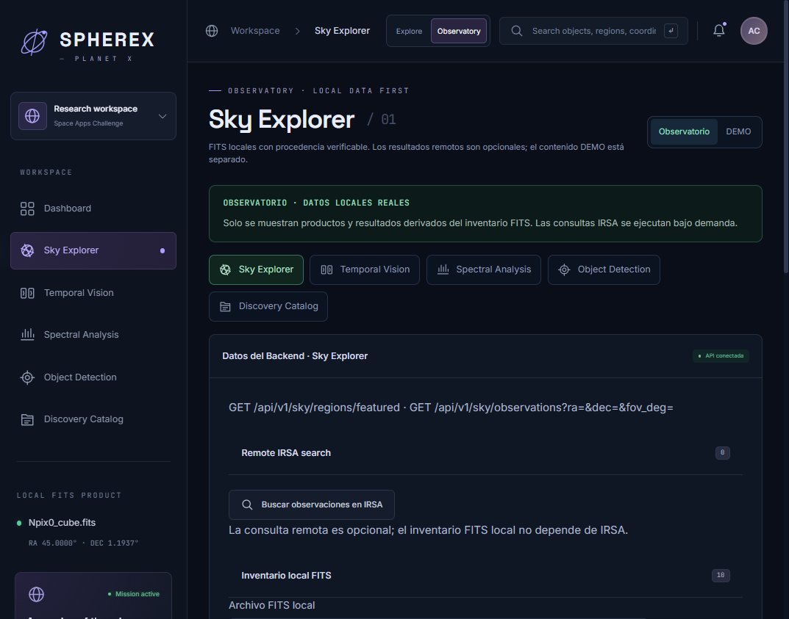
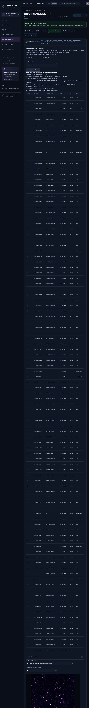
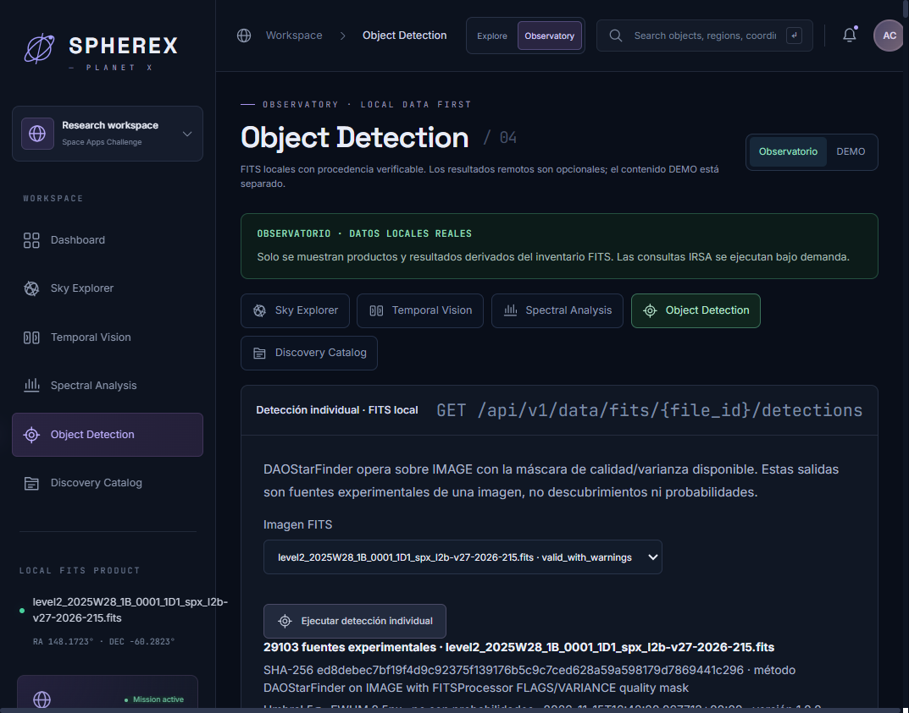
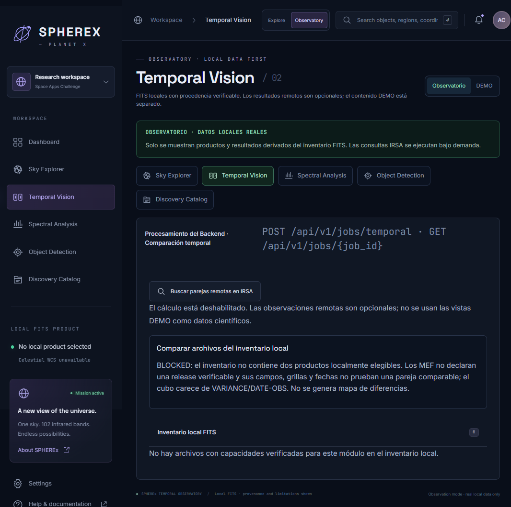
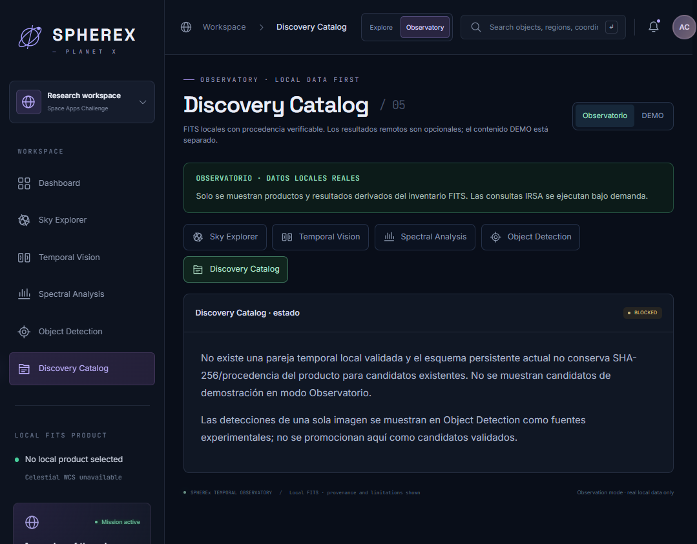
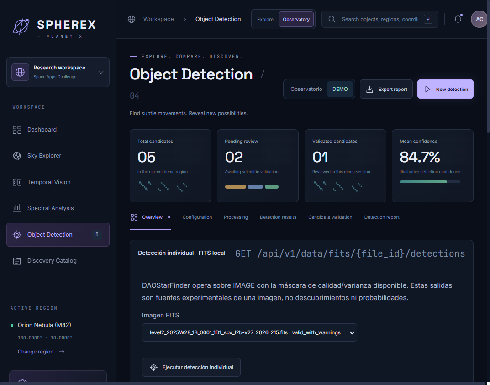

# Fase 4.3 — Integración local-first SPHEREx

**Ejecución:** 2026-11-15  
**Resultado general:** `PASS_WITH_LIMITATIONS`  
**Conclusión:** el inventario FITS local, Sky Explorer y la extracción desde el cubo funcionan desde la interfaz con datos originales. IRSA no completó la búsqueda espacial dentro del timeout; no existe una pareja temporal local elegible ni un catálogo científico persistente. El observatorio no se declara completamente operativo.

## 1. Datos y protección

Ruta comprobada: `Backend/app/data/raw/spherex/`. Se encontraron diez FITS no vacíos. El inventario físico y `Backend/app/data/processed/spherex/fits-manifest.json` coinciden en diez SHA-256; los diez hashes del manifiesto se verificaron contra los bytes originales. No se movieron ni modificaron los FITS.

El manifiesto contiene **909,264,960 bytes**: nueve productos `spectral_image_mef` y un `all_sky_spectral_cube`. Todos se clasifican `valid_with_warnings`; no se asignó DR1/QR3 porque no hay una etiqueta de release verificable. Los nombres que incluyen `v27` no se tomaron como prueba suficiente del release.

| FITS original | Bytes | SHA-256 |
|---|---:|---|
| `level2_2025W28_1B_0001_1D1_spx_l2b-v27-2026-215.fits` | 61,511,040 | `ed8debec7bf19f4d9c92375f139176b5c9c7ced628a59a598179d7869441c296` |
| `level2_2025W28_1B_0002_1D1_spx_l2b-v27-2026-215.fits` | 68,391,360 | `9bbf5ff345c36c0f95689a856f788562e48bc56fe792a558c1cbc4a16b195bde` |
| `level2_2025W28_1B_0003_1D1_spx_l2b-v27-2026-215.fits` | 60,094,080 | `1e7318b504635f0de620de975e5109a5b83aca560fd07096a4ec881d32a733a2` |
| `level2_2025W25_1B_0429_1D1_spx_l2b-v27-2026-213.fits` | 70,381,440 | `921b24805a3213467ef6a8502bb4af4231be78f4bd1b99802b52609c7d83d28c` |
| `Npix0_cube.fits` | 320,909,760 | `a595a4511dc0b63e0a4c1fb3d0a7735317f17ebf1d11d774888b2566bdb870bc` |
| `level2_2025W17_4B_0001_1D1_spx_l2b-v27-2026-196.fits` | 65,393,280 | `b2b78466058203dbabcf841b6223697e7e69b08b18a00882c764c6f8fd0acd59` |
| `level2_2025W17_4B_0001_1D2_spx_l2b-v27-2026-196.fits` | 65,079,360 | `3d51d09b5a8653b21ec0bbdaffa923545af8bdb5af4b4a2b42fe260b4f5a3b9a` |
| `level2_2025W18_1B_0001_1D1_spx_l2b-v27-2026-196.fits` | 67,213,440 | `64113e82f4357303d9a595e384a51cd1e021e74c3ce81443d31ee74d42f8619a` |
| `level2_2025W30_1B_0001_1D1_spx_l2b-v27-2026-220.fits` | 65,306,880 | `6b0061a1bea9539b4fe4ae288911c770d08b058ac900a068ddb28490192cc3a6` |
| `level2_2025W42_1A_0001_1D1_spx_l2b-v27-2026-243.fits` | 64,984,320 | `bfcd10b34d3222855ea9cd92b6e103e56b90949d92c399f8a5d36a608c0d970e` |

`fits-consumers.json` no estaba presente. Los consumidores se derivan de las capacidades inspeccionadas; el archivo opcional puede restringirlos, pero no asignar capacidades que el producto no tenga:

| Filtro `module` de `/api/v1/data/fits` | Productos |
|---|---:|
| `sky_explorer` | 10 |
| `spectral_analysis` | 10 |
| `object_detection` | 9 |
| `temporal_vision` | 0 |
| `discovery_catalog` | 0 |

El cubo no se asigna a detección porque ese flujo requiere una imagen 2D; ningún FITS bruto se asigna al catálogo porque una detección individual no es un candidato validado.

## 2. Causa y correcciones

- Los diez productos aparecían en el inventario general, pero las listas por módulo estaban vacías porque no había consumidores configurados. La asignación ahora se deriva de la clasificación, HDUs, datos, WCS y capacidades, y el filtro de API devuelve esos productos.
- Se clasifican los nueve MEF `IMAGE`/`VARIANCE`/`FLAGS` y el cubo 3D de 102 canales. La extracción del cubo usa `SPECTRAL_CHANNELS.WAVELENGTH` y comprueba sus valores contra el WCS 3D; no interpola canales.
- La inspección WCS omite HDUs vacíos y tablas. Las advertencias SIP originales no se suprimen: Astropy advierte que hay coeficientes SIP con `CTYPE` sin sufijo `-SIP`; la exactitud absoluta de esas transformaciones necesita confirmación/calibración del producto.
- Una coordenada fuera de la cobertura WCS podía acabar en `cannot convert float NaN to integer`. Se añadieron guardas finitas para MEF y cubo; ahora la API devuelve un `422` con una razón de cobertura explícita.
- La ausencia de release ya no invalida por sí sola una posible pareja. Estas observaciones siguen sin ser elegibles porque faltan otros metadatos de compatibilidad (banda/calibración/PSF/grilla y, para el cubo, `DATE-OBS`/varianza).
- El `IrsaClass` instalado no ofrece `query_tap`. El cliente de TAP usa PyVO y valida `TAP_SCHEMA`/`spherex.obscore`; IRSA permanece opcional frente a los FITS locales.
- En modo Observatorio se ocultan los contadores de candidatos de ejemplo y la barra lateral identifica el FITS seleccionado y su centro WCS, no la región ilustrativa predeterminada. El contenido de demostración permanece en el modo `DEMO`.

## 3. Arranque, HTTP y navegador

Tras detener los procesos existentes, se iniciaron los servicios desde sus directorios:

```powershell
# Backend/
python -m uvicorn app.main:app --host 127.0.0.1 --port 8000

# Frontend/
pnpm dev --host 127.0.0.1 --port 8443
```

Después del arranque limpio: frontend `/` **200**, backend `/health` **200**, `/docs` **200** y los cinco filtros de inventario **200** con los totales anteriores. CORS respondió `Access-Control-Allow-Origin: http://127.0.0.1:8443`. En el navegador real se observaron solicitudes al catálogo, metadatos, preview PNG, perfil espectral y detección; no hubo errores CORS ni errores de página. Los `422` de la posición inválida son respuestas esperadas y el error se presenta en la interfaz.

Limitación de infraestructura: al arrancar no estaba disponible PostgreSQL (error de decodificación de configuración) ni Redis. La aplicación inició con SQLite local y caché en memoria; las rutas científicas locales respondieron. Esto no valida persistencia compartida.

En los logs también apareció `Error crítico no controlado:` sin detalle en el manejador global mientras varias rutas locales terminaban con HTTP **200**, y un `ConnectionResetError` de Windows al cerrarse una conexión cliente durante la navegación. No se ocultaron; requieren correlación e investigación. El timeout IRSA sí quedó registrado con excepción y respuesta **502**.

### Sky Explorer — `PASS_WITH_LIMITATIONS`

Desde la interfaz se cargó el catálogo real, se cambió del primer MEF a `Npix0_cube.fits`, y el `src`/identificador de la imagen cambió al producto seleccionado. El preview del cubo respondió `200 image/png`, **512 × 512**, con centro WCS **RA 45.000000°, Dec 1.193748°**. La selección corresponde al SHA-256 `a595a451…870bc`. Se conserva la advertencia SIP ya descrita.



### Spectral Analysis — `PASS_WITH_LIMITATIONS`

Flujo ejecutado desde la interfaz para `Npix0_cube.fits`, coordenadas `(45°, 1.193748°)`:

- API `GET /api/v1/data/fits/60a077eb-47e2-504c-9f69-1573d0ef83f9/spectral-profile?ra=45&dec=1.193748`: **200**.
- 102 canales; 91 mediciones válidas; longitudes de onda tabuladas de **0.75300002 a 4.98799992 µm**, unidad `MJy / sr`.
- No hay extensión `VARIANCE`: incertidumbres `null`; el perfil queda con calibración `partial_unverified_provenance` y advertencias explícitas.
- Posición fuera del cubo `(180°, 10°)`: **422**, “Las coordenadas quedan fuera de la cobertura espacial del cubo”.

También se obtuvo una muestra MEF real: **0.90816905 µm**, flujo **0.67773777 MJy/sr**, error **0.02980640 MJy/sr**, flag `2097152`. Es una sola muestra WCS-W, no un espectro ensamblado. La respuesta advierte que la tabla WCS-WAVE no se usa en ese método; no se presenta como extracción espectral calibrada integral.



### Object Detection — `PASS_WITH_LIMITATIONS`

El detector individual se ejecutó en la interfaz sobre el MEF SHA-256 `ed8debec…41c296`: `DAOStarFinder`, umbral **5σ**, con máscara `FLAGS`/`VARIANCE`. Respondió **200** y produjo **29,103 detecciones** con coordenadas y métricas. El resultado especifica que no son probabilidades ni descubrimientos validados y que no hubo asociación temporal ni clasificación astrofísica. No se hizo evaluación fiable de falsos positivos; el volumen alto exige revisión antes de cualquier uso científico.



### Temporal Vision — `BLOCKED`

El inventario y la interfaz muestran cero productos localmente elegibles. La explicación indica que los MEF no prueban release/calibración/PSF/grilla/fechas compatibles, mientras que el cubo carece de `VARIANCE` y `DATE-OBS`. La comparación permanece deshabilitada y no se genera mapa de diferencias.



### Discovery Catalog — `BLOCKED`

No se mostraron candidatos de ejemplo ni se promocionaron las detecciones individuales. La interfaz explica que no hay pareja local validada y que el almacenamiento actual no conserva la procedencia/hash necesarios para candidatos científicos.



### Separación DEMO/Observatorio — `PASS`

El cambio a `DEMO` mostró contenido ilustrativo con la etiqueta persistente `NASA Space Apps concept · DEMO workspace`. De vuelta en Observatorio, el contador de ejemplo desapareció, no había identificadores `PX-2025-*`, y la barra lateral mostró el FITS y centro WCS seleccionados.



## 4. IRSA — `PASS_WITH_LIMITATIONS`

La consulta real de `TAP_SCHEMA` verificó **62 columnas** de `spherex.obscore`, incluidas `obs_id`, `s_ra`, `s_dec`, `access_url` y `dataproduct_type`; `em_min`/`em_max` tienen unidad `m`. La consulta espacial real no terminó: PyVO agotó el timeout de **30 s**. `GET /api/v1/sky/observations?ra=45&dec=1.193748&fov_deg=0.5` respondió **502** con un mensaje claro de que IRSA no está disponible y los FITS locales siguen disponibles. No se usaron respuestas simuladas. El acceso local siguió operativo.

## 5. Trazabilidad

Las respuestas de perfil/detección incluyen el ID y nombre del producto, SHA-256, coordenadas (perfil), método, parámetros, unidades, banderas/advertencias, fecha de procesamiento y versión del software. No se encontró persistencia durable de esos resultados científicos; el catálogo sigue bloqueado y no se duplicaron los FITS originales.

## 6. Pruebas y comandos

| Comando/comprobación | Resultado |
|---|---|
| `python -m pytest tests/test_fits_inventory.py tests/test_fits_data_api.py tests/test_irsa_client.py -q --tb=short` | Exit 0; **23 passed**, 20 warnings |
| `pnpm typecheck` | Exit 0 |
| `pnpm build` | Exit 0; Vite produjo el bundle |
| `python -m uvicorn app.main:app --host 127.0.0.1 --port 8000` | Arrancó y HTTP verificado; se detuvo intencionalmente tras las pruebas; el shell reportó `-1` al terminar el proceso de servidor |
| `pnpm dev --host 127.0.0.1 --port 8443` | Vite listo y navegador verificado; se detuvo intencionalmente; el shell reportó `4294967295` (`-1`) al terminar el proceso de servidor |
| Recuento SHA-256 de los FITS frente al manifiesto | Exit 0; 10/10 coinciden |
| Búsqueda espacial TAP a IRSA | Timeout real a los 30 s; API 502, sin fallback simulado |

Las advertencias de pruebas no se ocultaron: incluyen deprecaciones de Starlette/httpx/pyparsing y advertencias Astropy de convergencia WCS al probar coordenadas fuera de cobertura.

## 7. Archivos modificados y generados

- Backend: `app/services/fits_inventory.py`, `app/services/fits_processor.py`, `app/api/v1/endpoints/data.py`, `app/services/irsa_client.py`, `app/api/v1/endpoints/sky.py`, `app/api/v1/endpoints/spectral.py`, `requirements.txt`.
- Pruebas: `tests/test_fits_inventory.py`, `tests/test_fits_data_api.py`, `tests/test_irsa_client.py`.
- Frontend: `src/api/fits.ts`, `src/App.tsx`, `src/index.css`.
- Manifiesto regenerado: `app/data/processed/spherex/fits-manifest.json`.
- Evidencia visual nueva: seis PNG en `Backend/reports/evidence/`.

## 8. Pendientes priorizados para Fase 5

1. Resolver el timeout de consultas espaciales IRSA y probar consulta/descarga real de productos sin bloquear la operación local.
2. Obtener/validar metadatos oficiales de release, calibración, banda, PSF, WCS y fechas; confirmar la advertencia SIP con documentación del producto.
3. Adquirir observaciones compatibles, validar alineación/resolución/máscaras/incertidumbres y recién entonces habilitar Temporal Vision.
4. Evaluar falsos positivos y calibración del detector; revisar la salida de 29,103 fuentes y evitar tratar sus métricas como probabilidades.
5. Implementar persistencia versionada con hash, producto de origen, coordenadas, parámetros, unidades, incertidumbres, calidad, software y fecha; solo promover detecciones a catálogo con evidencia suficiente.
