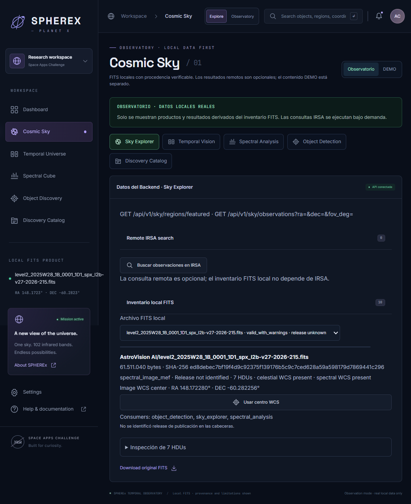
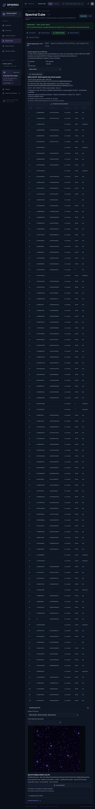
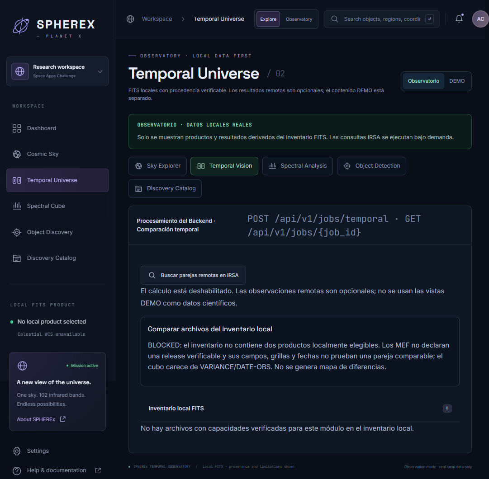
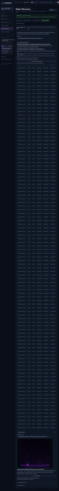
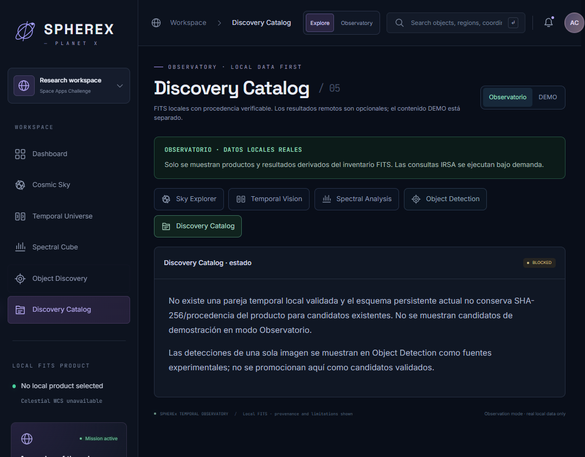

# Fase 4.4 — Validación científica y end-to-end

**Fecha de ejecución:** 2026-11-15  
**Datos:** `Backend/app/data/raw/spherex/`  
**Manifiesto:** `Backend/app/data/processed/spherex/fits-manifest.json`

## Conclusión ejecutiva

Se validaron flujos reales desde el navegador hasta el backend con los FITS locales: el inventario contiene diez archivos íntegros, Sky Explorer sirve previews PNG derivados de FITS, la extracción del cubo produce 91 canales válidos de 102 y la detección individual registra 29.103 fuentes experimentales. Las ejecuciones se recuperaron tras reiniciar el backend y sus hashes de resultado coincidieron al reproducirlas.

Esto **no** valida integralmente el observatorio: IRSA respondió con HTTP 502/timeout; no hay parejas temporales locales elegibles; no se verificó la release/calibración espectral completa; y las detecciones no tienen validación astrofísica ni control de falsos positivos. Discovery Catalog permanece bloqueado. Estado general: **PASS_WITH_LIMITATIONS**; no se declara el observatorio completamente operativo.

## Estados por capacidad

| Capacidad | Estado | Evidencia y limitaciones |
|---|---|---|
| Arranque Backend | PASS_WITH_LIMITATIONS | Uvicorn atendió `/health`, `/docs` y la API. PostgreSQL no estuvo disponible por un error de decodificación durante la conexión; el servicio continuó con SQLite local. Redis tampoco estuvo disponible y se usó caché en memoria. |
| Arranque Frontend | PASS | Vite 8.0.5 atendió `http://127.0.0.1:8443/`. No hubo conflicto de puertos en el arranque limpio. |
| CORS y comunicación frontend-backend | PASS | El preflight `OPTIONS` desde `http://127.0.0.1:8443` devolvió 200 e incluyó ese origen y los métodos GET/POST/OPTIONS. El navegador consumió JSON y previews binarios reales. |
| Integridad del inventario FITS | PASS | Diez FITS con contenido; los diez SHA-256 coincidieron con el manifiesto tanto antes como después de las pruebas. No se movieron ni modificaron los originales. |
| Inspección HDU y WCS | PASS_WITH_LIMITATIONS | Los HDU de imagen y tabla se distinguieron; las pruebas cubren WCS real y el round-trip pixel↔cielo en nueve MEF tuvo error inferior a `1.8e-6` píxeles en los puntos probados. Esto solo demuestra consistencia interna, no astrometría absoluta. |
| Sky Explorer | PASS | El navegador cargó el inventario de diez FITS, cambió entre dos imágenes y recibió previews PNG HTTP 200 con `X-FITS-File-ID` coincidente. Se mostraron SHA-256, tipo de producto, extensiones y centro WCS. |
| Extracción espectral real | PASS_WITH_LIMITATIONS | El cubo produjo 102 muestras con 91 canales válidos, longitudes de onda tabuladas verificadas contra WCS 3D y valores `MJy / sr`. Incertidumbres no disponibles y procedencia/calibración integral sin verificar. |
| Detección individual real | PASS_WITH_LIMITATIONS | DAOStarFinder ejecutó sobre un MEF real con máscaras FLAGS/VARIANCE y persistió 29.103 fuentes experimentales. El umbral usa dispersión global de IMAGE, no un modelo de ruido calibrado; no son descubrimientos ni probabilidades. |
| Temporal Vision | BLOCKED | El inventario devuelve cero productos elegibles. Los MEF no tienen release verificada ni evidencia suficiente de comparabilidad; el cubo carece de VARIANCE/DATE-OBS. El cálculo permaneció deshabilitado y no se generó diferencia. |
| Discovery Catalog | BLOCKED | No existe pareja temporal validada para promoción y no se asociaron las detecciones individuales con candidatos científicos. La interfaz no presentó resultados DEMO como reales. |
| Consulta real IRSA TAP | BLOCKED | La consulta real a `https://irsa.ipac.caltech.edu/TAP` respondió con HTTP 502 de proxy; la consulta iniciada desde el frontend agotó el timeout de 30 s y devolvió 502. La indisponibilidad no afectó el inventario local. |
| Persistencia y replay | PASS | Las ejecuciones espectral y de detección sobrevivieron al reinicio. Los replay produjeron hashes idénticos a los originales. |
| Pruebas automatizadas backend | PASS | 27 aprobadas, 20 advertencias de dependencias/Astropy; sin fallas. |
| Automatización de pruebas frontend | NOT_TESTED | `Frontend/package.json` no define un script de pruebas de componentes. Se hicieron flujos reales en navegador, además de typecheck y build. |

## Arranque, HTTP y CORS

Se comprobaron los puertos 8000 y 8443 libres, se detuvieron los procesos de la ejecución previa y se iniciaron los servicios desde sus directorios:

```powershell
# Backend/
python -m uvicorn app.main:app --host 127.0.0.1 --port 8000 --log-level info

# Frontend/
pnpm dev --host 127.0.0.1 --port 8443
```

En el arranque limpio, Uvicorn quedó escuchando en `127.0.0.1:8000` (PID 29268) y Vite en `127.0.0.1:8443` (PID 13980). Ambos procesos atendieron solicitudes HTTP. Los comandos de servidor se detuvieron explícitamente al terminar la validación; sus sesiones de terminal informaron `-1` al ser terminadas, no por fallo de arranque.

| Solicitud | Resultado |
|---|---|
| `GET /health` | 200, `{"status":"online","version":"1.0.0"}` |
| `GET /docs` | 200 |
| `GET /openapi.json` | 200 |
| `GET /api/v1/data/fits` | 200, 10 archivos |
| `GET http://127.0.0.1:8443/` | 200 |
| Preflight `OPTIONS /api/v1/data/fits` con origen frontend | 200; `Access-Control-Allow-Origin: http://127.0.0.1:8443` |
| `GET /` en Backend | 404; no hay ruta raíz configurada. `/health` y `/docs` sí están disponibles. |

Se corrigió `/health`: antes afirmaba `SPHEREx DR1/QR3` como texto fijo aunque el inventario no verifica esa release. Ahora expone la versión de la aplicación, no una atribución científica.

Durante una recarga deliberada del navegador se registraron `ERR_ABORTED` para la petición de regiones destacadas y para una consulta del inventario que se cancelaron al navegar. Coincidió con una entrada `Error crítico no controlado` vacía en el log de backend. No volvió a aparecer durante las operaciones estables; queda como observación para investigar si se reproduce sin recarga. Los HTTP 422 de coordenadas inválidas y el 502 de IRSA fueron respuestas esperadas de las pruebas, no errores CORS.

Extractos abreviados del log real de Uvicorn (UUIDs sustituidos por `...`):

```text
INFO:     Application startup complete.
INFO:     Uvicorn running on http://127.0.0.1:8000
INFO:     "GET /health HTTP/1.1" 200 OK
INFO:     "OPTIONS /api/v1/data/fits/.../spectral-runs?ra=45&dec=1.193748 HTTP/1.1" 200 OK
INFO:     "POST /api/v1/data/fits/.../spectral-runs?ra=45&dec=1.193748 HTTP/1.1" 201 Created
INFO:     "POST /api/v1/data/fits/.../spectral-runs?ra=180&dec=80 HTTP/1.1" 422 Unprocessable Entity
INFO:     "POST /api/v1/data/fits/.../detection-runs?threshold_sigma=5 HTTP/1.1" 201 Created
INFO:     "GET /api/v1/data/scientific-runs/... HTTP/1.1" 200 OK
INFO:     "GET /api/v1/sky/observations?ra=180&dec=80&fov_deg=0.5 HTTP/1.1" 502 Bad Gateway
```

## FITS reales y procedencia

La ruta efectiva contiene cinco subdirectorios por módulo. Hay nueve Spectral Image MEF y un cubo espectral; no se identificó un producto autónomo de calibración con procedencia verificable. La ausencia de release en headers queda como desconocida, no como incompatibilidad automática.

| Archivo | Clasificación | Bytes | SHA-256 |
|---|---|---:|---|
| `AstroVision AI/level2_2025W28_1B_0001_1D1_spx_l2b-v27-2026-215.fits` | Spectral Image MEF | 61.511.040 | `ed8debec7bf19f4d9c92375f139176b5c9c7ced628a59a598179d7869441c296` |
| `AstroVision AI/level2_2025W28_1B_0002_1D1_spx_l2b-v27-2026-215.fits` | Spectral Image MEF | 68.391.360 | `9bbf5ff345c36c0f95689a856f788562e48bc56fe792a558c1cbc4a16b195bde` |
| `AstroVision AI/level2_2025W28_1B_0003_1D1_spx_l2b-v27-2026-215.fits` | Spectral Image MEF | 60.094.080 | `1e7318b504635f0de620de975e5109a5b83aca560fd07096a4ec881d32a733a2` |
| `Discovery Intelligence/level2_2025W25_1B_0429_1D1_spx_l2b-v27-2026-213.fits` | Spectral Image MEF | 70.381.440 | `921b24805a3213467ef6a8502bb4af4231be78f4bd1b99802b52609c7d83d28c` |
| `Spectral Intelligence/Npix0_cube.fits` | All-Sky Spectral Cube | 320.909.760 | `a595a4511dc0b63e0a4c1fb3d0a7735317f17ebf1d11d774888b2566bdb870bc` |
| `SPHEREx Data Core/level2_2025W17_4B_0001_1D1_spx_l2b-v27-2026-196.fits` | Spectral Image MEF | 65.393.280 | `b2b78466058203dbabcf841b6223697e7e69b08b18a00882c764c6f8fd0acd59` |
| `SPHEREx Data Core/level2_2025W17_4B_0001_1D2_spx_l2b-v27-2026-196.fits` | Spectral Image MEF | 65.079.360 | `3d51d09b5a8653b21ec0bbdaffa923545af8bdb5af4b4a2b42fe260b4f5a3b9a` |
| `Temporal Sky Engine/level2_2025W18_1B_0001_1D1_spx_l2b-v27-2026-196.fits` | Spectral Image MEF | 67.213.440 | `64113e82f4357303d9a595e384a51cd1e021e74c3ce81443d31ee74d42f8619a` |
| `Temporal Sky Engine/level2_2025W30_1B_0001_1D1_spx_l2b-v27-2026-220.fits` | Spectral Image MEF | 65.306.880 | `6b0061a1bea9539b4fe4ae288911c770d08b058ac900a068ddb28490192cc3a6` |
| `Temporal Sky Engine/level2_2025W42_1A_0001_1D1_spx_l2b-v27-2026-243.fits` | Spectral Image MEF | 64.984.320 | `bfcd10b34d3222855ea9cd92b6e103e56b90949d92c399f8a5d36a608c0d970e` |

El manifiesto conserva la inspección HDU de cada producto. Los nueve MEF repiten: HDU 0 PrimaryHDU sin array; HDU 1 IMAGE 2040×2040 con WCS celeste/espectral; HDU 2 FLAGS 2040×2040; HDU 3 VARIANCE 2040×2040; HDU 4 ZODI 2040×2040; HDU 5 EPSF BinTableHDU con 441 filas (campos CWAVE/CBAND/EPSF); HDU 6 WCS-WAVE BinTableHDU con una fila. El cubo repite: HDU 0 PrimaryHDU sin array; HDU 1 IMAGE, HDU 2 NHITS y HDU 3 FLAGS, cada uno 102×512×512; HDU 4 SPECTRAL_CHANNELS con 102 filas; HDU 5 WCS-WAVE con una fila. El cubo no tiene VARIANCE ni DATE-OBS. La inspección evita construir WCS de imagen para tablas o HDU sin datos de imagen. Los diez hashes anteriores coinciden con `fits-manifest.json`; no se regeneró ni alteró el manifiesto durante estas pruebas.

Inventario servido por módulo:

| Filtro | Archivos |
|---|---:|
| `sky_explorer` | 10 |
| `spectral_analysis` | 10 |
| `object_detection` | 9 |
| `temporal_vision` | 0 |
| `discovery_catalog` | 0 |

## Resultados científicos reproducibles

### Sky Explorer

Desde el navegador se seleccionaron dos MEF diferentes. Ambos previews devolvieron HTTP 200, `image/png`, HDU IMAGE y `X-FITS-File-ID` correspondiente al archivo elegido; el nombre/alt y el SHA-256 visibles cambiaron con el producto. Para el primer archivo se mostró centro WCS RA `148.172280°`, DEC `-60.282256°`. Las imágenes proceden del endpoint de preview del backend y no de una imagen estática genérica.

### Spectral Analysis

Ejecución del cubo `Npix0_cube.fits`, archivo `60a077eb-47e2-504c-9f69-1573d0ef83f9`, SHA-256 `a595a4511dc0b63e0a4c1fb3d0a7735317f17ebf1d11d774888b2566bdb870bc`:

- `POST /api/v1/data/fits/{file_id}/spectral-runs?ra=45&dec=1.193748`: **201**.
- Centro de consulta: RA `45°`, DEC `1.193748°`.
- 102 canales; 91 válidos. Fuente de longitudes de onda: `SPECTRAL_CHANNELS.WAVELENGTH; checked against 3D WCS`.
- Unidad: `MJy / sr`; no hay VARIANCE, por lo que `flux_error=null` e incertidumbre `unavailable`.
- Estado de calibración: `partial_unverified_provenance`; no se afirma calibración integral.
- En los MEF se identificaron las tablas EPSF/CWAVE/CBAND y WCS-WAVE, pero el endpoint validado para MEF usa una muestra de un píxel por WCS-W y no demuestra una calibración integrada basada en esas tablas.
- Muestra real: canal 0, `0.75300002098 µm`, `0.02794748172 MJy / sr`, flag `2097152`, válido; canal 2, `0.79000002146 µm`, flux `null`, flag `524288`, inválido.
- Run `a393ee84-a0ec-4d1a-a547-8116e60ec087`, digest `3a406276d4a8a112fc9d8b6687aea6b560d325af1be9817c14f69d98dcc33735`.
- En la ejecución de interfaz posterior al reinicio se creó también el run `714271d6-9d65-4683-94c4-0688ff364fae`, con el mismo archivo, centro, 91/102 canales válidos y digest.
- Recuperación GET tras reinicio: **200**. Replay POST: `exact_match=true`, mismo digest y SHA-256 de origen.
- Coordenadas fuera del cubo (RA `180°`, DEC `80°`) desde la interfaz: **422**, mensaje visible de falta de cobertura. Coordenadas fuera de rango (361°, 91°) en API: **422**.

El MEF ofrece una muestra de un píxel por WCS-W, no un espectro integrado ni una unión de bandas; la interfaz lo identifica como tal y muestra la limitación.

### Detección de fuente individual

Ejecución de `level2_2025W28_1B_0001_1D1_spx_l2b-v27-2026-215.fits`, SHA-256 `ed8debec7bf19f4d9c92375f139176b5c9c7ced628a59a598179d7869441c296`:

- `POST /api/v1/data/fits/{file_id}/detection-runs?threshold_sigma=5`: **201**.
- Método: DAOStarFinder sobre IMAGE con máscaras FLAGS y VARIANCE.
- Resultado: 29.103 fuentes experimentales. Ejemplo reproducible: ID `ed8debec7bf1:178.480:0.061`, RA `149.599287°`, DEC `-58.198281°`.
- Run original `4f690231-928f-4fbd-90e2-b1eaee924ba0`; digest `530c872e492d8e62f96ed07e1e1a81368930b4a1478ba2471868982a24652d71`.
- La ejecución desde la interfaz tras el reinicio (`676d2e5a-6e3a-401f-9c39-dad618550665`) obtuvo el mismo conteo y digest.
- GET de recuperación y replay posteriores: **200** y `exact_match=true`.
- La interfaz muestra 100 filas como máximo para evitar renderizar decenas de miles de filas; comunica el total y mantiene la ejecución completa persistida y recuperable. La respuesta API y persistencia no se truncan.
- El multiplicador de umbral no es significancia calibrada; no se hizo validación astrofísica ni evaluación de falsos positivos.

## IRSA, temporalidad y catálogo

`IRSAClient` usa `pyvo.dal.TAPService` y un timeout de 30 s. La consulta real de TAP al endpoint `/TAP/sync` terminó en HTTP 502 de proxy. Desde el navegador, el endpoint devolvió 502 con un mensaje explícito de timeout; el inventario local siguió mostrando los diez FITS. No se generaron respuestas IRSA simuladas ni se descargaron productos remotos.

Temporal Vision muestra `BLOCKED`, explica la falta de pareja y mantiene deshabilitado el cálculo; no genera mapas de diferencia. No se compararon imágenes con cobertura, banda, resolución, PSF, incertidumbres o procedencia no demostradas como compatibles.

Discovery Catalog muestra `BLOCKED`. Los resultados de una imagen se mantienen como fuentes experimentales y no se promocionan a candidatos validados ni a descubrimientos.

## Persistencia y trazabilidad

PostgreSQL no estuvo accesible desde este entorno; el backend usó `Backend/data/observatory.db` (SQLite). Las tablas `scientific_runs` y `scientific_detections` persistieron IDs de ejecución, archivo y ruta de origen, SHA-256, HDU, coordenadas/parámetros, unidades, máscaras, advertencias, timestamp, versión del software y digest del resultado. Se verificaron GET de recuperación después del reinicio y replay exacto para extracción y detección. La caché Redis también quedó en fallback de memoria, por lo que la durabilidad de producción sobre PostgreSQL/Redis sigue sin validarse.

## Pruebas y comandos

| Comando | Resultado |
|---|---|
| `python -m pytest tests/test_fits_inventory.py tests/test_fits_data_api.py tests/test_irsa_client.py tests/test_scientific_results.py tests/test_real_spherex_wcs.py tests/test_health.py -q --tb=short` (desde Backend) | Exit 0; 27 passed, 20 warnings. Incluye contratos IRSA, coordenadas inválidas, persistencia, replay y WCS real local. |
| `python -m py_compile app\main.py app\core\config.py app\services\fits_processor.py app\services\temporal_engine.py app\services\scientific_results.py app\models\database_models.py app\api\v1\endpoints\data.py tests\test_health.py` (desde Backend) | Exit 0. |
| Pylance syntax diagnostics sobre `app/main.py` y `tests/test_health.py` | Sin errores de sintaxis. |
| `pnpm typecheck` (desde Frontend) | Exit 0. |
| `pnpm build` (desde Frontend) | Exit 0. |
| Consulta real TAP | HTTP 502/timeout externo; ejecución documentada como BLOCKED, sin fallback sintético. |

Las 20 advertencias de pytest fueron principalmente deprecaciones de dependencias y advertencias Astropy al probar coordenadas fuera de cobertura; no se suprimieron. No se ejecutó una suite automatizada de frontend porque el paquete no define test runner.

## Evidencia visual

Capturas tomadas en navegador real desde la aplicación en modo Observatorio:

| Módulo | Captura |
|---|---|
| Sky Explorer — inventario y preview FITS |  |
| Spectral Analysis — cubo y perfil real |  |
| Temporal Vision — bloqueo por falta de pareja |  |
| Object Detection — fuentes experimentales reales |  |
| Discovery Catalog — bloqueo sin candidatos validados |  |

## Cambios realizados y pendientes

Cambios del trabajo de Fase 4.4: validación espectral MEF/cubo y WCS; tratamiento de valores inválidos/incertidumbres; máscara de detección; persistencia y replay de ejecuciones; precedencia de la ruta local `app/data`; flujos de recuperación desde la interfaz; corrección de `/health` para dejar de atribuir DR1/QR3 sin evidencia; límite de 100 filas visibles para una respuesta de detección grande, sin truncar el resultado persistido.

Requisitos antes de considerar operativo el observatorio:

1. Reintentar TAP/SIA cuando IRSA sea accesible; verificar respuestas del esquema/productos y procedencia de cualquier descarga.
2. Obtener release, calibración e incertidumbres verificables para validar plenamente los perfiles espectrales.
3. Conseguir al menos dos observaciones comparables con WCS, banda, resolución/PSF, calibración, masks y varianzas compatibles antes de habilitar Temporal Vision.
4. Validar fuentes experimentales contra un modelo de ruido y datos de referencia; solo después diseñar su asociación y promoción a catálogo.
5. Validar persistencia con PostgreSQL/Redis del entorno de despliegue y añadir pruebas automatizadas de frontend.
